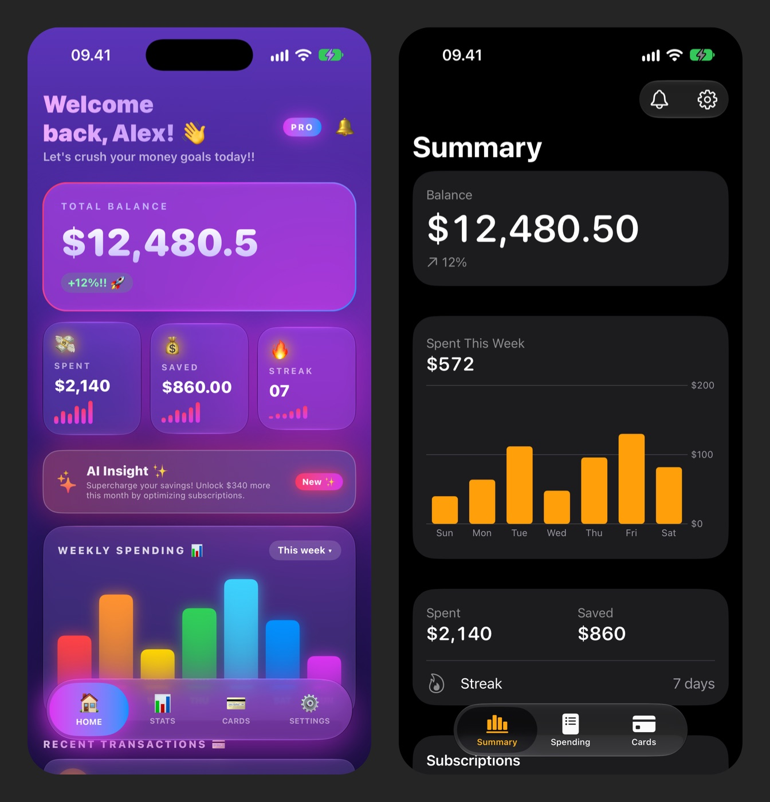

# unslop for SwiftUI

Adapted from [unslop](https://github.com/heydamir/unslop) by Damir Sokolovsky ([@heydamir](https://x.com/heydamir)), who started the [Unslopping series](https://x.com/heydamir/status/2115063463063998736) on X. This version rewrites the skill for SwiftUI and Apple's way of designing products.



unslop-swiftui is a skill for Claude that turns vibecoded, AI-looking SwiftUI into an app that feels designed the Apple way. Native to the platform, and with its own character. It finds the slop first: purple gradients, glowing cards, emoji labels, hand-built tab bars, glass on every card, fixed font sizes and shouty copy. Then it sets a direction from your product and fixes the screen pass by pass, like a designer doing a redline review, following the Human Interface Guidelines and Liquid Glass. It works on iOS, iPadOS, macOS, watchOS and visionOS.

## Install

For Claude Code, install it with the [skills](https://github.com/vercel-labs/skills) CLI.

```bash
npx skills add ardhitama/unslop --skill unslop-swiftui -a claude-code -g
```

Drop `-g` to install it into the current project only. Or copy the skill into your skills folder by hand.

```bash
git clone https://github.com/ardhitama/unslop
mkdir -p ~/.claude/skills && cp -r unslop/skills/unslop-swiftui ~/.claude/skills/
```

For a single project, copy it into `.claude/skills/` inside that project instead.

## Use

In Claude Code, type `/unslop-swiftui` with what you want, or just ask in your own words and Claude picks the skill up by itself.

```
/unslop-swiftui the home screen
/unslop-swiftui SettingsView.swift, keep our brand orange
/unslop-swiftui the dashboard and make the story video so I can post it
```

It audits the screen and proposes a direction before it edits anything, so you can steer it early. If the screen is already good, it tells you so and suggests a few small refinements instead of redesigning it.

## What it does

- **Audit.** Lists every sign of slop with the file and line where it lives.
- **Direction.** Product, task, context, the feeling it should create, and the moments where color carries real information, all taken from your product. Plus the questions only you can answer, asked before any edit.
- **Apple's way.** Built on the eight design principles in Apple's Human Interface Guidelines. It starts from the one task the screen is for, puts that answer first, moves custom chrome onto system components, keeps the accent for what people can tap, and treats accessibility as part of the design. It never invents data, comparisons or decoration.
- **Passes.** Structure, spacing, color, symbols, copy, type, layout, details, visuals, motion and accessibility, in that order.
- **Screenshots.** `scripts/sim.sh snapshot` builds your scheme for a simulator and captures light, dark and the largest accessibility text size, so the screen is judged as people see it.
- **Review.** Holds the result next to the closest screen in Apple's own apps as the bar for quality, not a layout to copy. On a full redesign, a second agent then reviews the screenshots with a fresh eye, without the plan or the reasons behind it. The report lists every finding and what was not checked.
- **Scope.** It owns the screen and its edges: states, Dynamic Type, VoiceOver, localization and privacy. Widgets, App Intents, the app icon and App Store art become short notes in the report, not changes.
- **Visuals.** Builds moments in code first, like Swift Charts, MapKit and card shaped objects. When an empty state or welcome page needs art, it can generate it through an image service like fal, Replicate, OpenAI images or Higgsfield, and it shows the prompt and asks before every paid generation.
- **Story video.** A square video of your screen unslopping itself, ready to post. SwiftUI animates the change, the simulator records it, and `scripts/sim.sh record` crops it. It needs only Xcode.

## Requirements

Xcode 26 or later with an iOS simulator, for the screenshots and the story video. The guidance covers Liquid Glass APIs from iOS 26 and macOS 26, and tells Claude to put them behind availability checks when your deployment target is older.

## Try it

[examples/SpendWise](examples/SpendWise) is a vibecoded budget app with every tell. Open the folder in Claude Code and run `/unslop-swiftui HomeView.swift`.

## Credits

The method, the direction, the passes, the story video and the original references are by Damir Sokolovsky ([@heydamir](https://x.com/heydamir)). For the original skill for web screens, and to have Damir unslop a screen for you, see [heydamir.design/unslop](https://heydamir.design/unslop).

Changes in this version: rewritten for SwiftUI and Apple platforms, with a structure pass for system components and Liquid Glass, an accessibility pass, Apple's text styles, semantic colors and SF Symbols in place of web tokens, a simulator script in place of the Playwright scripts, and a SwiftUI example in place of the HTML examples. The comparison with the closest Apple screen and the fresh-eye review are adapted from [Stageshow](https://github.com/benjitaylor/skills) by Benji Taylor.

## License

[CC BY 4.0](LICENSE). Use it, change it and share it, including commercially, as long as you credit Damir Sokolovsky ([@heydamir](https://x.com/heydamir)), link back to [the original repository](https://github.com/heydamir/unslop), and say that this version was changed.
